# HomePanel

An open-source, touch-screen smart home panel for the Raspberry Pi. One dark,
simple screen for the lights, plugs and TVs in your home — from many brands at
once — controlled directly over your Wi-Fi.

<p align="center">
  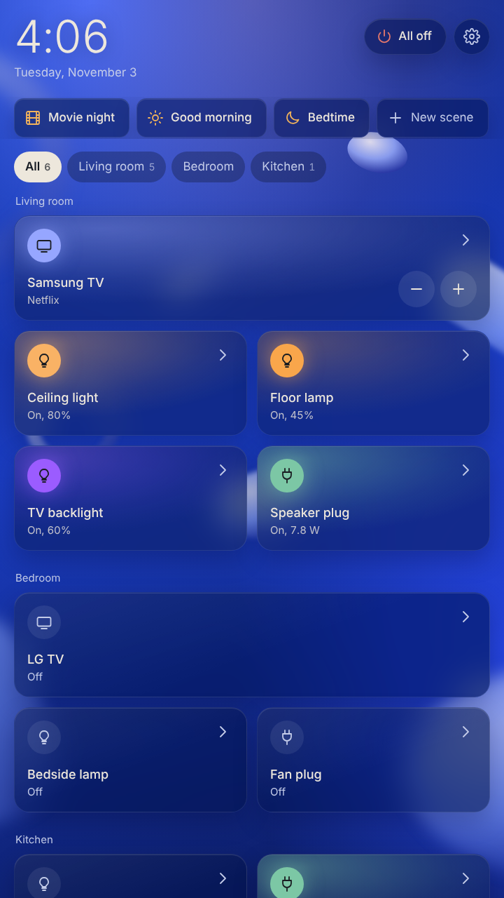
  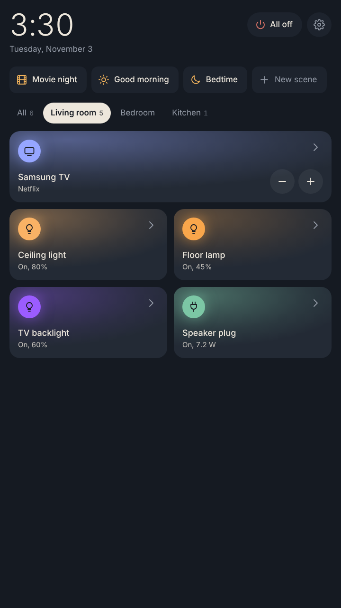
  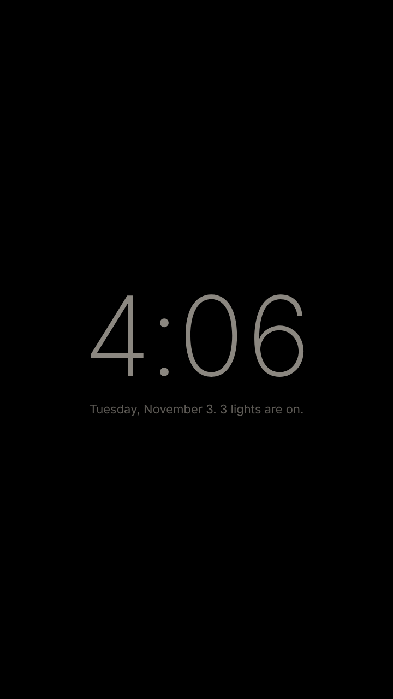
</p>
<p align="center">
  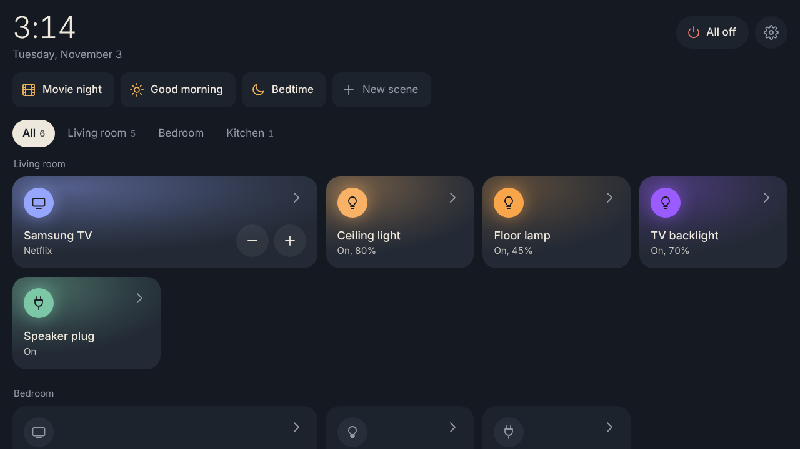
</p>

- **Touch-first glass UI.** A **Home page** of widgets you arrange yourself (long-press to edit): a big clock, clocks for India and the US, weather, scenes, rooms and device shortcuts, the same on every screen. A **Rooms** page with a tab for each room, down the side on an iPad or a landscape panel. Tap a tile to switch it, long-press (or tap "…") for full controls.
- **A sky that matches outside.** The background follows the weather and time of day (or pick Ocean, Aurora or Night), under frosted-glass tiles with adjustable transparency. Lit lights glow in their real color.
- **Works on iPhone and iPad too.** Safe areas, no sideways scrolling, and "Add to Home Screen" for a full-screen app.
- **Many brands, one screen.** Globe Electric / Tuya / Smart Life, Govee, TP-Link Kasa & Tapo, Shelly, WiZ, Philips Hue, Samsung TVs, LG TVs and LG sound bars.
- **Local first.** Everything except Govee plugs is controlled directly on your network — it keeps working when the internet is down.
- **Privacy.** The panel makes no internet calls of its own unless you ask for them in Settings → Location and presence:
  - **Weather** (opt-in): the server asks [Open-Meteo](https://open-meteo.com) (free, no account) for the weather about every 20 minutes, sending only your location rounded to about 1 km.
  - **Use my location** (only when you tap it): the browser's own location is used if it can ask for it (HTTPS or localhost; it shows its own permission prompt). Otherwise the server looks up your home's approximate location from its internet address at [ipapi.co](https://ipapi.co), with [ipwho.is](https://ipwho.is) as a backup. The place name comes from [BigDataCloud](https://www.bigdatacloud.com/free-api/free-reverse-geocode-to-city-api), sent your location rounded to about 1 km. Nothing is saved until you tap Save location, and you can always type your location instead.
- **Scenes and rooms.** "Movie night", "Bedtime", or "All off" for a room or the whole house.
- **Schedules and automations.** At a time of day, at sunset/sunrise (computed locally), or when everyone leaves / someone comes home (phones on Wi-Fi).
- **Resting clock faces.** When nobody has touched the panel for a while it shows a dim clock: big digital, analog with hands, a word clock ("It's quarter past ten"), date and day (with sunrise, sunset and lights on), or a very dim red night face. With weather turned on, the faces also show the temperature and a drawn weather icon, plus your place name. Pick one with a preview in Settings → Display and clock. The clock drifts slowly around the screen to avoid burn-in, and touching it only wakes the panel.
- **Photo frame.** A full-screen slideshow of family photos, added from any phone's browser. It can start by itself when the panel is idle, switches to a dim clock at night, and one touch goes back to the controls.
- **Energy history.** Plugs that measure power show watts now, kWh today and a 7-day chart.
- **Works with Home Assistant.** Already run Home Assistant? Add its lights, switches and TVs here, rooms included.
- **Works from phones too.** Open `http://homepanel.local:8080` in any browser on your Wi-Fi.
- **Built to extend.** A stable API on top, one small file per brand underneath. See [Adding a device brand](app/adapters/README.md).

## Supported devices

| Brand | Devices | How it connects | Setup |
|---|---|---|---|
| Globe Electric, Feit, Gosund, Treatlife, any Smart Life app device | Plugs, switches, bulbs | Local (Tuya protocol) | One-time Tuya developer key, [guide](docs/DEVICE_SETUP.md#globe-electric-and-other-tuya--smart-life-devices) |
| Govee | Plugs | Govee cloud API | Free API key, [guide](docs/DEVICE_SETUP.md#govee) |
| Govee | Lights with "LAN Control" | Local | Toggle LAN Control in the Govee app |
| TP-Link Kasa / Tapo | Plugs, switches, bulbs | Local | TP-Link login for newer models |
| Shelly | Plugs, relays | Local | None |
| WiZ / Philips WiZ | Bulbs | Local | None |
| Philips Hue | Bulbs, strips, plugs | Local via Hue Bridge | Press the bridge button once |
| Samsung | Tizen smart TVs (2016+) | Local | Accept the prompt on the TV once |
| LG | webOS smart TVs | Local | Accept the prompt on the TV once |
| LG | Sound bars with Wi-Fi (2018+) | Local | None, [guide](docs/DEVICE_SETUP.md#lg-sound-bars) |
| Home Assistant | Anything it controls: lights, switches, fans, TVs, speakers | Local (Home Assistant REST API) | Long-lived access token |
| Ecovacs Deebot | Robot vacuums | Ecovacs cloud | Ecovacs Home app login; needs Python 3.14, [guide](docs/DEVICE_SETUP.md#ecovacs-deebot-robot-vacuums) |

Want another brand? It's usually one file — see [app/adapters/README.md](app/adapters/README.md).

## What to buy

| Item | Notes |
|---|---|
| **Raspberry Pi 5, 2GB** | Plenty for this app. More RAM costs much more in 2026 and doesn't help here. |
| **Raspberry Pi Touch Display 2 (7")** | Official screen, no drivers needed, 720×1280, 5-finger touch. The 5" version is cheaper if space is tight. |
| **Official 27W USB-C power supply** | Under-powered chargers cause random freezes. |
| **32–64GB microSD card** (A2 rated) | SanDisk or Samsung. |
| **Case or stand made for Pi 5 + Touch Display 2** | Must say *Touch Display 2*; cases for the original 7" screen don't fit. |
| Active Cooler (optional) | Recommended in a closed case. |

Details and prices: [docs/HARDWARE.md](docs/HARDWARE.md).

## Try it on your computer first (no hardware needed)

Needs Python 3.11 or newer.

```bash
git clone https://github.com/leshwar/homepanel.git
cd homepanel
make setup        # creates .venv and installs everything
make dev          # pretend devices → open http://localhost:8080
```

Without `make` (e.g. Windows):

```bash
python -m venv .venv
.venv\Scripts\activate            # macOS/Linux: source .venv/bin/activate
pip install -r requirements-dev.txt
python -m app.main --demo --debug
```

To control **your real devices** from your laptop (same Wi-Fi), run `make run`
(or `python -m app.main --debug`), open http://localhost:8080, then Settings → Add a device.

## Install on the Raspberry Pi

1. Flash **Raspberry Pi OS (64-bit, with desktop)** with Raspberry Pi Imager. In the Imager's settings, set the hostname to `homepanel`, your Wi-Fi, and a username.
2. Connect the Touch Display 2 (ribbon cable + the two power wires to the GPIO pins), boot, then:

```bash
git clone https://github.com/leshwar/homepanel.git ~/homepanel
cd ~/homepanel
./scripts/install.sh
sudo reboot
```

The panel opens full-screen after boot. Add devices from the panel, or more
comfortably from your phone at `http://homepanel.local:8080` (typing API keys
is easier there).

Server-only (no screen): `./scripts/install.sh --no-kiosk`.

Prefer Docker? `docker compose up -d --build` runs the server (host networking,
so device search works on the Pi). Try it on any computer with
`make docker-demo`. Details and Mac caveats: [docs/DOCKER.md](docs/DOCKER.md).

## Use it on your phone or tablet

The panel is a web page, so any phone, tablet or laptop on the same Wi-Fi can use
it: open the panel's address in Safari or Chrome. The address is shown in
**Settings → Diagnostics** and in the log at start-up, for example
`http://192.168.1.20:8080`. (In Docker on a Mac, use your Mac's address from
System Settings → Wi-Fi → Details, with the port you opened, e.g. `:8081`.)

Anyone on your Wi-Fi who opens that address can control your devices; there's no
sign-in yet. Phone apps are planned for later (see [ROADMAP](docs/ROADMAP.md)).

## Logs and debugging

| What | Where |
|---|---|
| Log file (rotates, 5 × 2 MB) | `logs/homepanel.log` |
| On the Pi, live | `journalctl -u homepanel -f` |
| In the app | Settings → Diagnostics and logs (and "Download log file") |
| Verbose logging | add `--debug` (or `make dev` / `make run`, which already do) |
| Bug-report bundle | `./scripts/collect-logs.sh` → attach the `.tar.gz` to an issue (no keys or tokens included) |

Common fixes are in [docs/TROUBLESHOOTING.md](docs/TROUBLESHOOTING.md).

## More screens

| Light controls | TV remote | Energy |
|---|---|---|
| 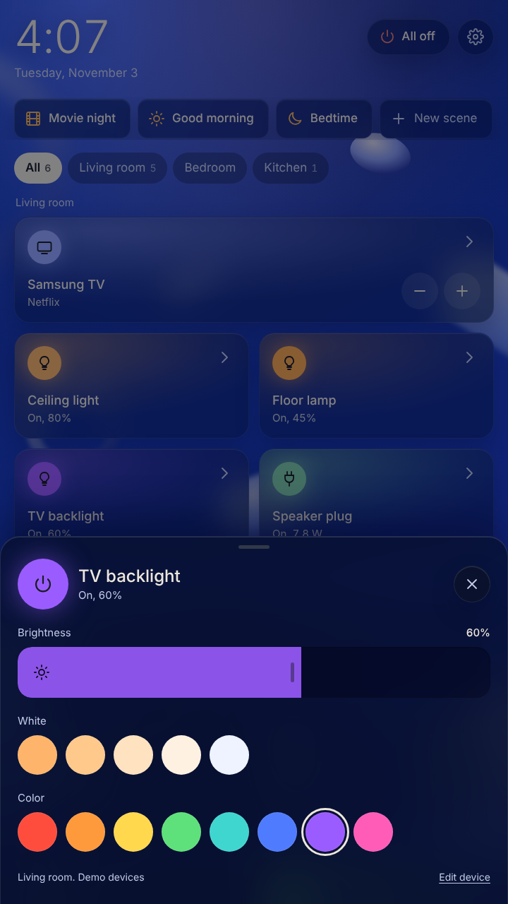 | 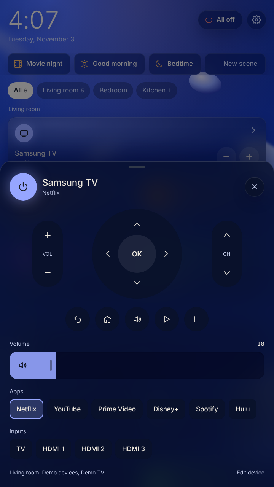 | 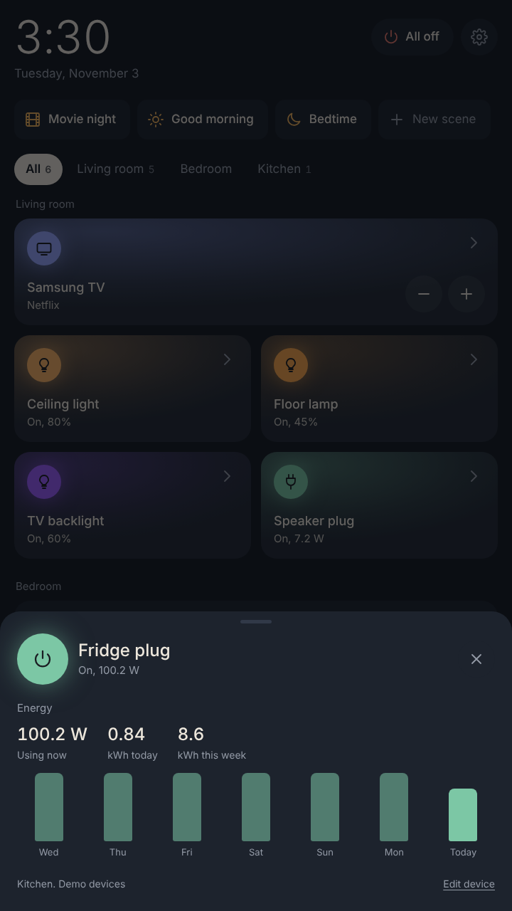 |

| Display: background and glass | Solid, clear, and Aurora |
|---|---|
| 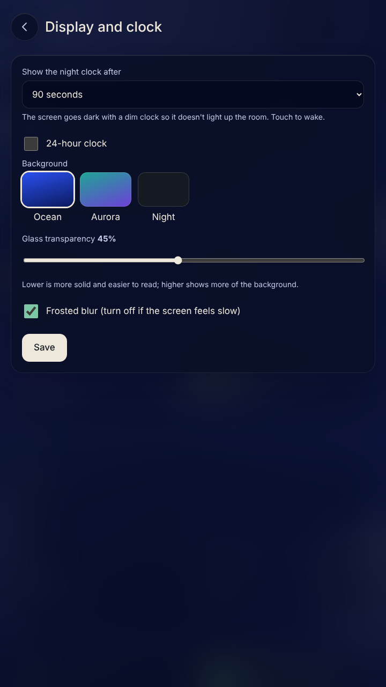 | 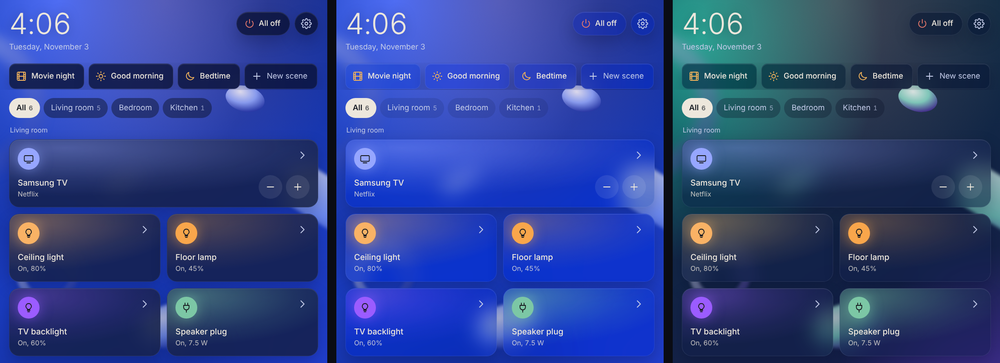 |

| Photo frame | Photo frame, landscape | Photo frame settings |
|---|---|---|
| 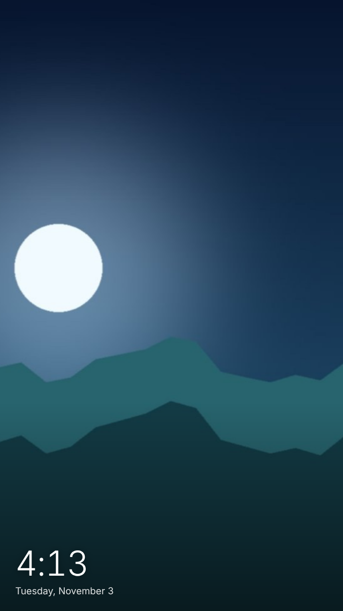 | 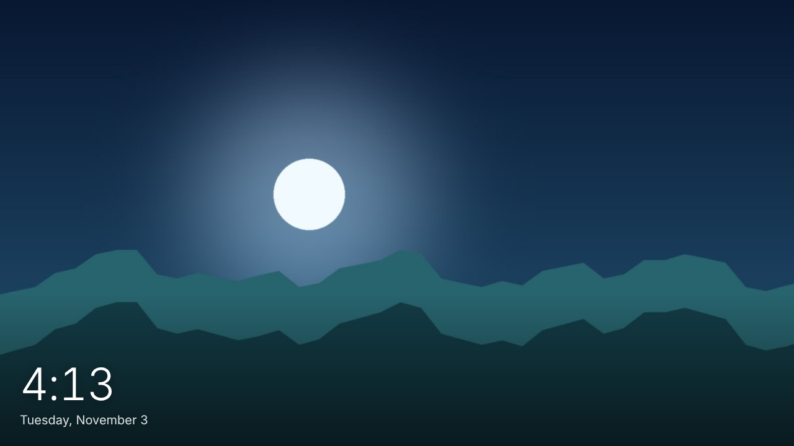 | 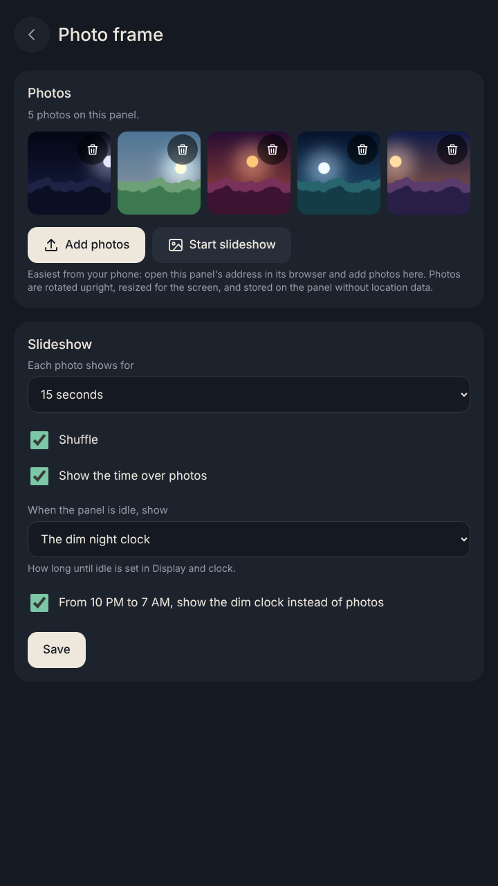 |

| Automations | New automation | Location and presence |
|---|---|---|
| 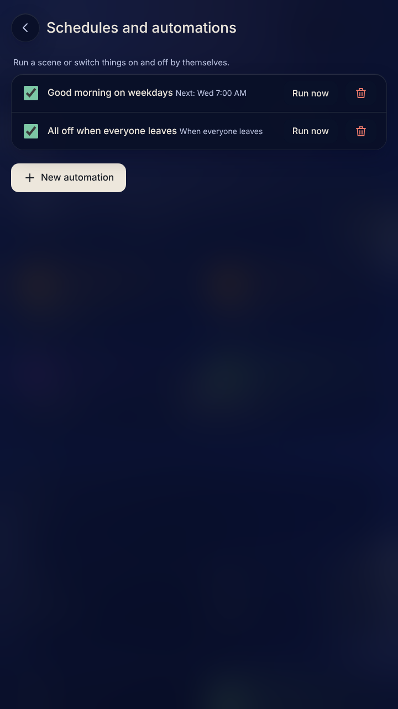 | 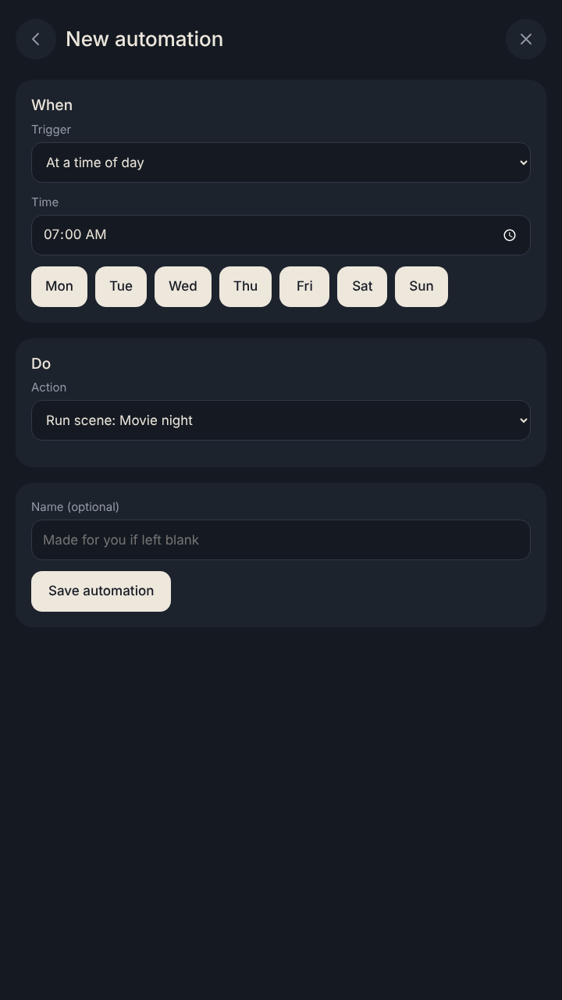 | 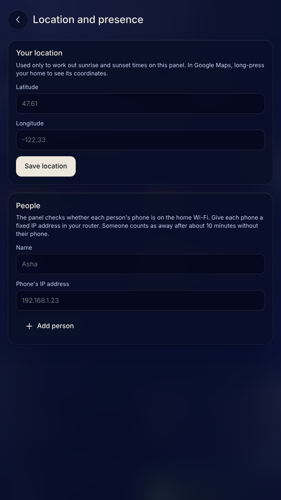 |

## How it's built

```
web/  (touch UI: HTML + CSS + JS, no build step)
  │  HTTP + live events (/api/v1)
app/api/        stable API — never changes when brands are added
app/core/       service: registry, state, polling, scenes, middleware (validate → normalize → log → retry),
                automations (time / sun / presence), energy history (SQLite), presence
app/core/adapter.py   the DeviceAdapter interface every brand implements
app/adapters/   one file per brand: tuya.py, govee.py, kasa.py, shelly.py, wiz.py, hue.py, samsung_tv.py, lg_tv.py,
                lg_soundbar.py, home_assistant.py, ecovacs.py
```

Read [docs/ARCHITECTURE.md](docs/ARCHITECTURE.md) for the full picture and
[docs/API.md](docs/API.md) for the API reference.

## Contributing

New brands, fixes and UI ideas are welcome. Start with [CONTRIBUTING.md](CONTRIBUTING.md).
If you use Claude Code, the project conventions are in [CLAUDE.md](CLAUDE.md).

```bash
make test-unit          # logic tests (no network)
make test-integration   # real server, simulated devices, browser UI
make lint
```

Every pull request runs lint, unit tests, integration tests and a Docker build;
pull requests that change code must include both kinds of tests. Merges to
`main` publish a Docker image for the Pi. See [docs/CI_AND_BRANCH_RULES.md](docs/CI_AND_BRANCH_RULES.md).

## Status

Early but working: the app, UI, demo mode and test suite run end to end. The
device adapters follow each brand's documented protocol or library; the Shelly
and Home Assistant adapters are tested against simulated devices, and the others
still need testing against real hardware. Reports are welcome: open an issue
with your device model and a log bundle. See [docs/TESTING_WITH_DEVICES.md](docs/TESTING_WITH_DEVICES.md).

## License

[MIT](LICENSE)
